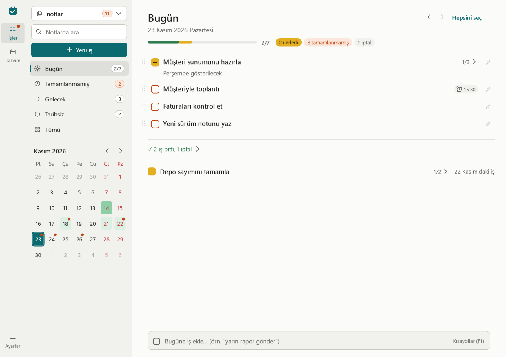

# İş Günlüğü (Work Journal)

[Türkçe](README.md) · **English**

A Windows desktop app that keeps your daily tasks in a plain `.txt` file. Your notes stay in your own file; the app shows them day by day, task by task. If you like, it syncs through Google Drive so the same notes appear on your other computers.

The app's interface is in Turkish only for now.

<picture>
  <source media="(prefers-color-scheme: dark)" srcset="docs/readme/bugun-koyu.png">
  
</picture>

## What it does

- **Day by day:** Today, Unfinished, Upcoming, Undated and All screens; week, month and year calendar.
- **Sub-tasks and descriptions:** Every task can have sub-tasks and a description, edited in the side panel.
- **Quick add:** Type "yarın rapor gönder" (send the report tomorrow) and the task lands on tomorrow. Win+Shift+N opens the add box from anywhere.
- **Reminders:** Up to two reminders for tasks with a time; a notification comes when it is due.
- **Keyboard:** The whole app works from the keyboard; F1 lists the shortcuts.
- **Several files:** A separate `.txt` file for each project, files sorted into groups.
- **Light and dark theme:** The layout holds whether the window is small or large.

## Download

The latest version is on the [Releases](https://github.com/Antagonist1/is-gunlugu/releases) page. `IsGunlugu.exe` needs no installation: download it and run it. Windows 10 and 11 already have the .NET Framework 4.8 it needs.

The exe is not signed, so on first launch Windows may say "Windows protected your PC". Choose **More info → Run anyway** to open it.

## File format

The notes can be read and edited in Notepad too:

```
----23/11/2026
🚨send the report
👍[Done 23/11]write the meeting notes
🚨call the customer ⏰[14:00 30dk 15dk]
	🚨a sub-task
		the sub-task's description
----tarihsiz
🚨a task for some day
```

`🚨` is an open task, `👍[Done dd/mm]` a finished one, `⏰[time …]` its reminders, a tab a sub-task. `----tarihsiz` heads the undated tasks.

## Building

You need Windows and the [.NET SDK](https://dotnet.microsoft.com/download) (9 or later).

```
dotnet build src/IsGunlugu/IsGunlugu.csproj -c Release
dotnet test tests/IsGunlugu.Tests
```

The desktop app targets .NET Framework 4.8 and needs nothing extra on Windows 10 and 11.

### Google Drive

Drive sync needs a desktop OAuth client in Google Cloud. The client's secret is not in the repository. To build with your own, follow the steps in [GoogleClient.Secret.example.txt](src/IsGunlugu/GoogleClient.Secret.example.txt). Without it the app still builds and runs; only the Drive connection is off.

## Project layout

| Folder | Contents |
|---|---|
| `src/IsGunlugu` | The desktop app (WPF) |
| `src/IsGunlugu.Core` | The code that reads, writes and syncs the note file |
| `tests/IsGunlugu.Tests` | Tests |
| `docs` | The [user guide](https://antagonist1.github.io/is-gunlugu/kilavuz.html) (Turkish) and its pictures |

The version history is in [CHANGELOG.md](CHANGELOG.md) (Turkish).

## License

[MIT](LICENSE)
