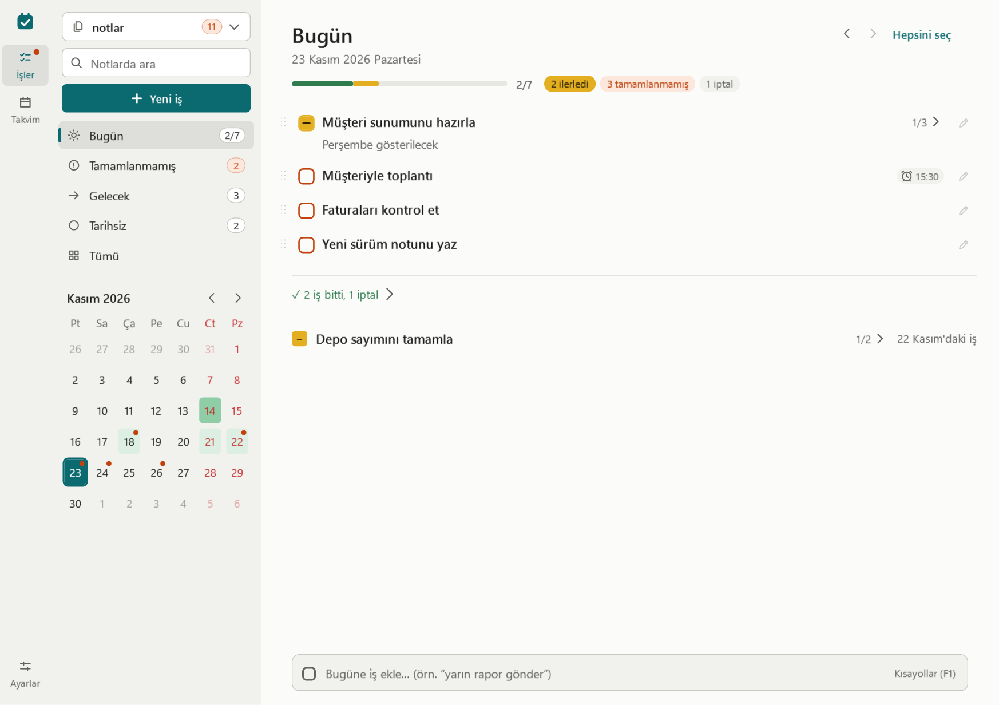

# İş Günlüğü

**Türkçe** · [English](README.en.md)

Günlük işleri düz bir `.txt` dosyasında tutan Windows masaüstü uygulaması. Notlar senin dosyanda durur; uygulama onları gün gün, iş iş gösterir. İstersen Google Drive'a eşitlenir, başka bilgisayarlarda da aynı notlar görünür.

<picture>
  <source media="(prefers-color-scheme: dark)" srcset="docs/readme/bugun-koyu.png">
  
</picture>

## Neler yapar

- **Gün gün işler:** Bugün, Tamamlanmamış, Gelecek, Tarihsiz ve Tümü ekranları; hafta, ay ve yıl takvimi.
- **Alt iş ve açıklama:** Her işin alt işleri ve açıklaması olur. Sağ panelde düzenlenir.
- **Hızlı ekleme:** "yarın rapor gönder" yazınca iş yarına eklenir. Win+Shift+N her yerden ekleme kutusunu açar.
- **Hatırlatıcı:** Saatli işlere en fazla iki hatırlatma kurulur, vakti gelince bildirim gelir.
- **Klavye:** Uygulamanın tamamı klavyeyle kullanılır; F1 kısayolları gösterir.
- **Birden çok dosya:** Her proje için ayrı `.txt` dosyası tutulur, dosyalar gruplara ayrılır.
- **Açık ve koyu tema:** Pencere küçülse de büyüse de düzen bozulmaz.

Ayrıntılı anlatım [kullanım kılavuzunda](https://antagonist1.github.io/is-gunlugu/kilavuz.html).

## İndir

Son sürüm [Releases](https://github.com/Antagonist1/is-gunlugu/releases) sayfasında. `IsGunlugu.exe` kurulum istemez: indirip çalıştırman yeterli. Windows 10 ve 11'de .NET Framework 4.8 zaten yüklüdür.

Exe imzasız olduğu için Windows ilk açılışta "Windows kişisel bilgisayarınızı korudu" diyebilir. **Ek bilgi → Yine de çalıştır** ile açılır.

## Dosya biçimi

Notlar Not Defteri'nde de okunup düzenlenebilir:

```
----23/11/2026
🚨rapor gönder
👍[Done 23/11]toplantı notlarını yaz
🚨müşteriyi ara ⏰[14:00 30dk 15dk]
	🚨alt iş
		alt işin açıklaması
----tarihsiz
🚨bir gün bakılacak iş
```

## Derleme

Gerekenler: Windows ve [.NET SDK](https://dotnet.microsoft.com/download) (9 ya da üstü).

```
dotnet build src/IsGunlugu/IsGunlugu.csproj -c Release
dotnet test tests/IsGunlugu.Tests
```

Masaüstü uygulaması .NET Framework 4.8 hedefler, Windows 10 ve 11'de ek kurulum istemez.

### Google Drive

Drive eşitlemesi için Google Cloud'da bir masaüstü OAuth istemcisi gerekir. İstemcinin gizli anahtarı depoda yoktur. Kendi anahtarınla derlemek için [GoogleClient.Secret.example.txt](src/IsGunlugu/GoogleClient.Secret.example.txt) dosyasındaki adımları izle. Anahtar olmadan da uygulama derlenir ve çalışır; yalnızca Drive bağlantısı kapalı olur.

## Proje yapısı

| Klasör | İçerik |
|---|---|
| `src/IsGunlugu` | Masaüstü uygulaması (WPF) |
| `src/IsGunlugu.Core` | Not dosyasını okuyan, yazan ve eşitleyen kod |
| `tests/IsGunlugu.Tests` | Testler |
| `docs` | Kullanım kılavuzu ve kılavuzun görüntüleri |

Sürüm geçmişi [CHANGELOG.md](CHANGELOG.md) dosyasında.

## Lisans

[MIT](LICENSE)
